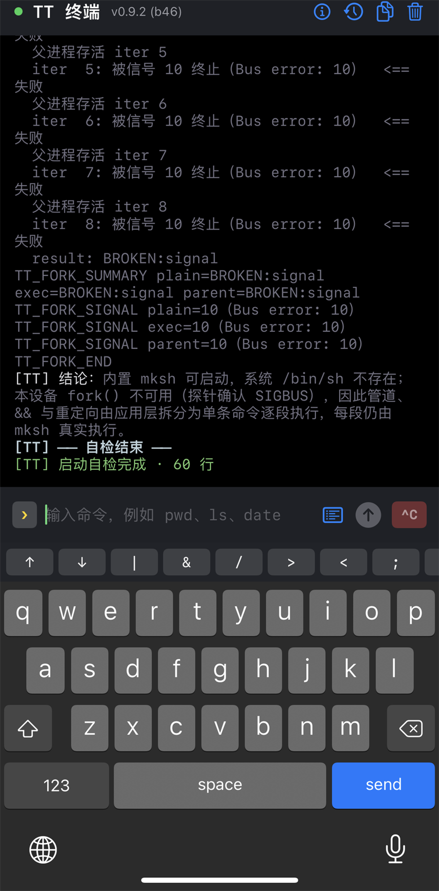
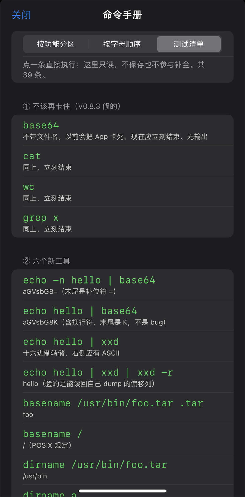
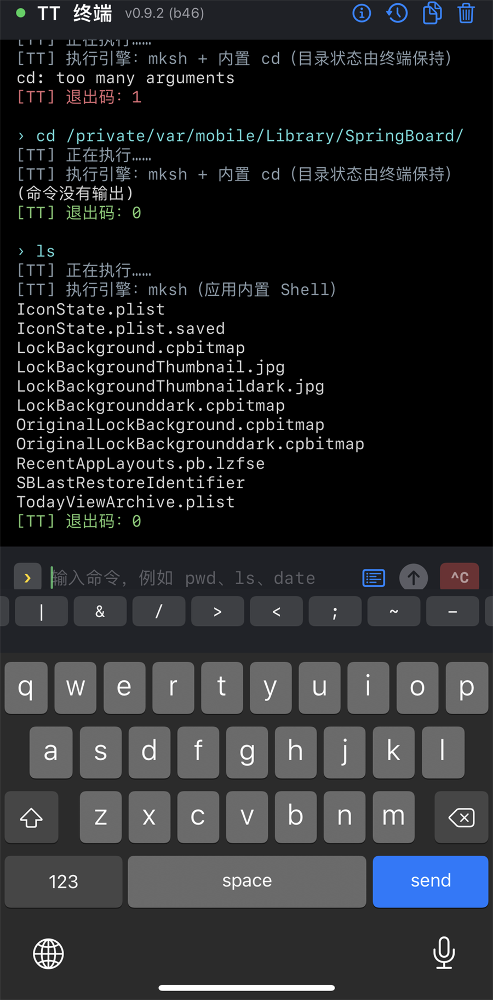

# TT 终端

面向 iPhone 的轻量终端。**免越狱**，用 TrollStore 侧载；命令由应用内置的
`mksh` 与 **33 个自编译工具**真实执行，不是玩具模拟器。

## 界面

| 首屏与附件栏 | 内置自测清单 | 真实执行 |
|---|---|---|
| [](docs/01-main-and-accessory-bar.png) | [](docs/03-test-checklist.png) | [](docs/06-real-execution.png) |

**测试清单**是 TT 最有辨识度的功能：命令手册顶部第三个分区，把每一版要验的语句
内置成分组的清单，**点一条直接执行**，下面灰字就是该看到什么。
不用每次手敲一长串命令，也就不会漏测——v0.9.1 的两个 bug 就是它亲手抓出来的。

更多：[命令手册·按功能分区](docs/02-manual-by-category.png) ·
[脚本编辑器](docs/04-script-editor.png) ·
[手册左滑编辑/删除](docs/05-manual-swipe-actions.png) ·
[权限检测报告](docs/07-capability-report.png)

## 当前版本（v0.9.2）

- **控制流可用**：`for` / `if` / `while` / `case` 单行直接跑，含嵌套。
- **命令手册**：42 条内置条目，三个浏览分区——按功能、按字母、**测试清单**。
- **补全**：命令名、选项、路径三路候选，随输入实时弹出。
- **危险命令硬拦截**：`DangerGuard` 一律不执行，弹窗里**没有放行按钮**（见下）。
- **权限检测报告**：一键测出这台设备上 TT 实际能碰什么、哪些目录写得动。
- 管道、`&&`、`||`、`;`、`>`、`>>`、`<` 均可用；**当前目录跨命令保持**。
- 保留中文界面、长按选择/复制、一键复制全部、清屏、输入历史。

### 三套自检，共 182 例，提交前必须全绿

| 脚本 | 例数 | 覆盖 |
|---|---|---|
| `scripts/danger_guard_selftest.ps1` | 65 | `DangerGuard`（34 拦 + 31 放） |
| `scripts/controlflow_selftest.ps1` | 77 | `ControlFlowDetector` + `&&`/`\|\|` 短路 + 防分叉守卫 |
| `scripts/completion_selftest.ps1` | 40 | 选项解析 / 补全链路 / 路径补全白名单 |

```
powershell -NoProfile -ExecutionPolicy Bypass -File .\scripts\danger_guard_selftest.ps1
powershell -NoProfile -ExecutionPolicy Bypass -File .\scripts\controlflow_selftest.ps1
powershell -NoProfile -ExecutionPolicy Bypass -File .\scripts\completion_selftest.ps1
```

> ⚠️ 这三个都是 Swift 逻辑的 **PowerShell 移植版**（本机没有 Swift 编译器）。
> 移植版够不着 Swift，**分叉过一次**：v0.8.2 的「变量跨分号」修复在 Swift 那边
> 手译错了，51 例照样全绿，直到真机执行才暴露。改 Swift 的同一段逻辑时
> 必须同步改脚本；真正的兜底是 App 内的**测试清单**。

## 安全策略：高危命令一律硬拦截

v0.4.16 起，`DangerGuard` **不再按权限分级**，命中的命令一律不执行，弹窗里没有放行按钮。

起因是一次真机事故：旧版逻辑是"非 root → 只弹一次确认，点「仍然执行」就放行"，
弹窗还写着"这条命令只能影响本 App 权限范围内的数据"。**这个前提是错的**——
应用带着 `no-sandbox`、`platform-application`、`MobileContainerManager.allowed`
这些 entitlement（见 `tt.entitlements`），**不是 root 也写得动 `/var/mobile/Library`
下的系统数据**。一条 `rm -rf /` 下去，设置里大片变英文、桌面布局重置、Apple Watch 连不上。

> **权限等级不能用来决定"要不要给人放行"**：破坏不可逆，而放行只要点一下。

> 这个脚本上线当天就抓出两个真 bug：归一化会把命令转成小写，而 `chmod-R777/` 和
> `chown-R` 两条规则却拿**大写 `R`** 去比，导致 `chmod -R 777 /`、`chown -R root /`
> 从来没被拦过。详见根目录 `AGENTS.md`。

## 内置命令

系统那 314 个可执行文件里几乎一个有用的都没有，所以工具链全是自编译的
（`scripts/tttools/*.c`，共 **32** 个，加 `mksh` 共 33 个进 `ttbin/`）：

| 分区 | 命令 |
|---|---|
| 文件与目录 | `ls` `cat` `cp` `mv` `rm` `mkdir` `touch` `find` `stat` `du` `df` |
| 文本处理 | `head` `tail` `wc` `grep` `sort` `uniq` `cut` `tr` `nl` `base64` `xxd` |
| 信息查询 | `date` `whoami` `id` `which` `uname` `basename` `dirname` |
| 新增工具 | `seq` `tee` |

> `seq` / `tee` / `nl` / `base64` / `xxd` / `basename` / `dirname` / `which` / `id`
> 都是本项目新写的——iOS 上一个都没有。

## 已知限制

### `fork()` 在本机不可用，所以循环体只能用内建命令

ttfork 探针确认 fork 子进程出生即 SIGBUS（三阶段 8/8 全中），而 `posix_spawn()`
完全正常。控制流是**整段交给 mksh** 跑的，因此 `for` / `if` / `while` / `case` /
变量赋值 / 通配符展开全都由 mksh 自己完成，**一次 fork 都不需要**。
但循环体一旦调用外部命令（`seq`、`ls`、`cat`），mksh 必须 fork，就会踩到 SIGBUS——
这种情况会给**明确报错**（退出码 `128+10` = 138），不会闪退。

```
for i in 1 2 3 4 5; do echo 第 $i; done      ✅ 五行
for i in 1 2; do seq $i; done                ⚠️ 报 fork/SIGBUS 说明，不是 bug
```

### 内置 mksh R59c 不支持花括号展开

实测（在 CI 上编一份同源宿主机 mksh 跑探针确认）：

| 写法 | 结果 |
|---|---|
| `for i in {1..5}; do echo $i; done` | 只循环一次，输出 `{1..5}` |
| `set -B` / `set -o ksh93` | `unknown option`——**开关不存在** |
| `set -o braceexpand` | 选项存在但**完全无效** |
| `for ((i=0;i<3;i++))` | `syntax error` |

范围循环请写 `for i in 1 2 3 4 5`。探针工具留在
`.github/workflows/mksh-probe.yml` + `scripts/mksh_probe.sh`，
推到 `probe/**` 分支就能复跑，**不改版本号、不发 Release**。

### 其他

- 变量与环境**不跨命令保留**（同一行内可以）。**当前目录会跨命令保持**。
- 不支持交互式程序（`vim`、`top`）。
- `whoami` 返回 `mobile`（应用身份，uid 501）；不是 root。
- 系统不含任何 shell（`/bin/sh`、`/usr/bin/true` 均 ENOENT），userland 全靠内置。

## 获取安装包

Releases 页面下载 `.ipa`，TrollStore 打开即可安装。无需开发者证书。

> 从浏览器下载时它可能把 `.ipa` 存成 `.zip`，改回 `.ipa` 后缀再装，内容没变。

## 本地构建

`TT/ttbin/`、`scripts/ttprobe`、mksh 都是 CI 现场编译的产物，已在 `.gitignore` 中忽略。
本地构建必须与 CI 同序——**先生成工具，再生成 Xcode 工程**：

```bash
SYSROOT="$(xcrun --sdk iphoneos --show-sdk-path)"
xcrun -sdk iphoneos clang -arch arm64 -isysroot "$SYSROOT" -O2 -o scripts/ttprobe scripts/ttprobe.c
mkdir -p TT/ttbin
for t in ls cat date whoami uname df wc head tail grep \
         touch mkdir rm cp mv sort uniq cut tr du stat find seq tee nl \
         base64 xxd basename dirname which id; do
  xcrun -sdk iphoneos clang -arch arm64 -isysroot "$SYSROOT" -O2 -o "TT/ttbin/$t" "scripts/tttools/tt${t}.c"
done
xcrun -sdk iphoneos clang -arch arm64 -isysroot "$SYSROOT" -O2 -o TT/ttbin/ttfork scripts/tttools/ttfork.c
bash scripts/build-mksh.sh
xcodegen generate
```

顺序不能颠倒：`project.yml` 把这些路径声明为资源，xcodegen 会校验它们存在。

**版本号唯一来源是 `build.yml` 的 `env.VERSION`**，`project.yml` 的
`MARKETING_VERSION` 必须与之一致——打包步骤会用 `PlistBuddy` 校验，不一致直接失败。

## 兼容性与构建

- 最低部署版本：**iOS 15.0**（在 iPhone 13 Pro Max / iOS 15.6.1 / TrollStore 真机验收）
- 界面：SwiftUI + UIKit 文本选择视图
- Xcode 工程：由 `project.yml` 自动生成，**不要手改 `.xcodeproj`**
- 编译平台：GitHub Actions 的 macOS 云端环境
- 安装：TrollStore；entitlements 由 TrollStore 应用，启动自检可核实

## 仓库目录说明

| 路径 | 是什么 |
|---|---|
| `TT/` | 应用界面与入口代码（`ContentView.swift` 一个文件装下全部 Swift） |
| `TT/ttbin/` | 内置命令工具（构建产物，不入库） |
| `docs/` | 界面截图（真机，iPhone 13 Pro Max / iOS 15.6.1） |
| `tt.entitlements` | 应用权限 |
| `scripts/tttools/*.c` | 32 个命令工具的源码 |
| `scripts/ttprobe.c` | 启动自检探针 |
| `scripts/build-mksh.sh` | 交叉编译 mksh + **自动扫目录**给嵌套二进制签名 |
| `scripts/*_selftest.ps1` | 三套自检（PowerShell 移植版，见上） |
| `scripts/mksh_probe.sh` | 问「这份 mksh 到底支持什么」的探针 |
| `.github/workflows/` | 编译发布（`build.yml`）与 mksh 探针（`mksh-probe.yml`） |

### 嵌套二进制必须逐个签名

打包时 `codesign --deep` **只签主程序**，`ttbin/*` 原样进包，TrollStore 安装时
只从主程序提取 entitlements，嵌套二进制最终是"无权限身份"，`posix_spawn` 拉起后
被 AMFI 立刻 SIGKILL（退出码 137）。真机表现为「命令莫名其妙被 9 终止」，
跟 C 代码本身毫无关系——**极难定位**。

`build-mksh.sh` 因此改成**自动扫 `TT/ttbin/`**，扫到什么签什么，并在打包步骤加了
全量校验硬闸。这事已经连着漏过两次（v0.6.0、v0.8.0 各加的工具全没签上）。

## 其他说明

- 启动自检输出：uid/euid、工作目录、运行时签名权限、ttbin 清单、三个启动探测、
  fork 能力探针与结论。
- 命令执行引擎与退出码每条输出都注明。